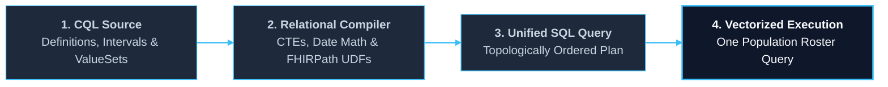

When clinical informaticists and healthcare data engineers talk about **CQL to SQL**, they are addressing an architectural divide in health IT: computable clinical knowledge—such as CMS electronic Clinical Quality Measures (eCQMs) and decision support guidelines—is authored in **HL7 Clinical Quality Language (CQL)**, but population analytics, quality reporting, and observational research run on relational data warehouses and SQL query engines.

*(Note: "CQL" is also the acronym for Cassandra Query Language in Apache Cassandra database migrations. This article is about the HL7 healthcare standard: compiling Clinical Quality Language into relational SQL queries).*

Traditionally, executing CQL has required an imperative, row-by-row Java engine (`cqframework` and HAPI FHIR). While that architecture works for transactional decision support on an individual patient in an EHR, evaluating thousands or millions of patients for quality reporting in a JVM quickly runs into memory and throughput walls.

Here is how compiling CQL directly to relational SQL works in `fhir4ds`, how the translator handles complex clinical constructs (temporal intervals, polymorphic choice fields, and terminology resolution), and the performance characteristics of running CQL as set-based relational algebra.

{/* truncate */}

## The Architectural Divide: Per-Patient Loops vs. Set-Based Relational Algebra

A clinical quality measure expressed in CQL defines a series of logical definitions over a patient's clinical history: demographics, clinical encounters, diagnostic reports, laboratory observations, and medications.

In the standard Java execution model, the engine iterates over the cohort sequentially. In contrast, compiling CQL to SQL evaluates the entire population in a single set-based query:

| | Traditional Java Engine (CQF / HAPI) | FHIR4DS (SQL on DuckDB) |
|---|---|---|
| Execution model | Imperative, row-by-row | Declarative, set-based |
| Deserialization | Every patient bundle parsed into JVM heap as Java POJOs | Columnar scans over raw NDJSON / Parquet — no per-patient objects |
| Vectorization | None — sequential interpretation in application code | SIMD vectorized across all CPU cores |
| Output | N individual evaluation bundles | One unified population roster |

For 100 patients, this is fast enough. At 5,000 to 50,000 patients, two bottlenecks emerge:
1. **Redundant deserialization:** Every patient bundle is parsed into JVM heap memory as thousands of Java POJOs (`Encounter`, `Observation`, `Condition`). In large cohorts, garbage collection overhead dominates total runtime.
2. **Missing columnar vectorization:** Analytical databases like DuckDB, ClickHouse, and BigQuery process data column-wise, operating over arrays of numbers and strings using SIMD instructions. An imperative loop in application code cannot leverage modern vectorized database planners.

Compiling CQL to SQL flips this model. The CQL library is parsed and translated **once** at deploy time into a single relational query. That query runs across the entire patient population in a single analytical pass.

## How the Translation Pipeline Works

CQL is a declarative, strongly-typed expression language with first-class support for clinical concepts, interval arithmetic, and three-valued logic (3VL). Compiling it to SQL requires three distinct translation stages:



### 1. Common Table Expressions (CTEs) for CQL Definitions

Each named `define` statement in a CQL library maps to a Common Table Expression (CTE) in the generated SQL. For example, consider this demographic and diagnostic screening logic:

```cql
library ScreeningExample version '1.0.0'
using FHIR version '4.0.1'

parameter "Measurement Period" Interval<DateTime>

define "In Age Demographic":
  Patient.gender = 'female'
    and AgeInYearsAt(start of "Measurement Period") between 50 and 74

define "Bilateral Mastectomy":
  [Procedure: "Bilateral Mastectomy Procedure"] P
    where P.status = 'completed'
      and P.performed starts on or before end of "Measurement Period"

define "Denominator Exclusion":
  exists "Bilateral Mastectomy"
```

The compiler translates these definitions into chained `MATERIALIZED` CTEs that resolve dependencies in topological order. This is the actual generated SQL (excerpted):

```sql
-- Actual fhir4ds output for the library above (DuckDB dialect, excerpt):
WITH _patients AS MATERIALIZED (
  SELECT DISTINCT ON (p.id) p.id AS patient_id, p.resource AS patient_resource,
         CAST(fhirpath_date(p.resource, 'birthDate') AS VARCHAR) AS birth_date
  FROM resources AS p WHERE p.id IS NOT NULL AND p.resourceType = 'Patient'
),
"Procedure: Bilateral Mastectomy Procedure" AS (
  SELECT DISTINCT r.patient_ref AS patient_id, r.resource,
         fhirpath_text(r.resource, 'performed') AS performed,
         COALESCE(json_extract_string(r.resource, '$.performedPeriod.start'),
                  json_extract_string(r.resource, '$.performedDateTime'),
                  json_extract_string(r.resource, '$.performedDate'),
                  json_extract_string(r.resource, '$.performedInstant')) AS performed_start,
         fhirpath_text(r.resource, 'status') AS status
  FROM resources r
  WHERE r.resourceType = 'Procedure'
    AND in_valueset(r.resource, 'code',
        'http://cts.nlm.nih.gov/fhir/ValueSet/2.16.840.1.113883.3.464.1003.198.12.1005')
    -- negation-profile guard: a "not done" Procedure is not positive evidence
    AND (json_extract(r.resource, '$.meta.profile') IS NULL OR NOT (
         list_contains(from_json(json_extract(r.resource, '$.meta.profile'), '["VARCHAR"]'),
             'http://fhir.org/guides/astp/us-quality-core/StructureDefinition/us-quality-core-procedurenotdone')))
),
"Bilateral Mastectomy" AS MATERIALIZED (
  SELECT * FROM "Procedure: Bilateral Mastectomy Procedure" AS P
  WHERE P.status = 'completed'
    AND LEFT(CAST(COALESCE(P.performed_start, '0001-01-01') AS VARCHAR), 10)
        <= LEFT(CAST(CAST('2025-12-31T23:59:59.999' AS VARCHAR) AS VARCHAR), 10)
),
"Denominator Exclusion" AS MATERIALIZED (
  SELECT _pt.patient_id FROM _patients AS _pt
  WHERE EXISTS (SELECT 1 FROM "Bilateral Mastectomy" AS sub
                WHERE sub.patient_id = _pt.patient_id)
)
SELECT _pt.patient_id, ...
```

### 2. Temporal Interval Arithmetic

A major strength of CQL is interval algebra (Allen's interval algebra). Expressions like `A during B`, `A starts before end of B`, or `A overlaps B` are translated into explicit comparison predicates on interval boundaries:

| CQL Expression | Relational SQL Lowering |
|---|---|
| `X during Interval[Start, End]` | `X >= Start AND X <= End` |
| `A overlaps B` | `A.start <= B.end AND A.end >= B.start` |
| `A starts on or before end of B` | `A.start <= B.end` |
| `DifferenceInDays(Start, End)` | `date_diff('day', Start, End)` |

### 3. Vectorized FHIRPath Extraction

Instead of converting entire JSON documents into SQL structs or relational columns ahead of time, `fhir4ds` utilizes native DuckDB C++ extensions (`fhirpath()` and `fhirpath_text()`). The database query engine extracts only the fields required by the active predicates directly from raw NDJSON or Parquet storage.

---

## Evaluating Measures in Python

Evaluating a standard CMS quality measure or custom CQL library takes four lines of Python:

```python
import fhir4ds

# 1. Connect to DuckDB
con = fhir4ds.create_connection()

# 2. Ingest patient resources
loader = fhir4ds.FHIRDataLoader(con)
loader.load_ndjson("patients.ndjson")

# 3. Evaluate the measure over the cohort
result = fhir4ds.evaluate_measure(
    library_path="./CMS125.cql",
    conn=con,
    parameters={"Measurement Period": ("2025-01-01", "2025-12-31")}
)

# 4. Extract results as a Pandas DataFrame
df = result.df()
print(df[["patient_id", "Initial Population", "Denominator", "Numerator"]])
```

For batch processing, translate once with `fhir4ds.translate_cql(...)` (or `translate_library_to_population_sql`): the result is a plain SQL string you can `PREPARE` and execute repeatedly across successive data loads — same plan, zero re-translation.

---

## What the Numbers Show: Scaling Characteristics

Two published benchmarks frame the speedup (both against the reference Java clinical-reasoning engine, on the current DuckDB 2.0.0-primary numbers):

- **Per-patient cost falls as cohort size grows (Synthea synthetic patients):** the fixed cost of planning and the patient roster is amortized across more rows — CMS68 drops from 0.45 ms/patient at 100 patients to 0.045 ms/patient at 5,000.
- **Per-measure execution (cqframework 2025 QI-Core test bundles):** median **~83× faster** per patient than the Java engine (mean ~31×).
- **At full scale, the gap widens (Synthea synthetic patients @5,000):** from ~23× to ~16,000× per measure depending on shape — and execution stays inside DuckDB's configured memory limits, with no JVM heap exhaustion.

---

## Testing CQL to SQL in Your Browser

Both DuckDB and the `fhir4ds` translation engine compile to WebAssembly, enabling zero-server clinical analytics:

- **[CQL Cleanroom](/docs/examples/cql-cleanroom/):** Author CQL, inspect the generated SQL in real time, and evaluate patient cohorts directly in a browser tab with zero data exfiltration.
- **[Interactive CQL Clinic](/docs/examples/cql-clinic/):** A twelve-lesson hands-on guide covering temporal intervals, choice types, and cohort definitions.
- **[CQL Documentation](/docs/user-guide/analytics/cql/):** Comprehensive reference for syntax, supported operations, and DQM integration.
