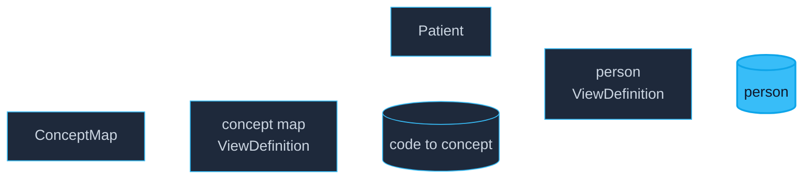

import ViewingRoomWC from '@site/src/components/ViewingRoomWC';

# OMOP, Step by Step

This page builds **one** OMOP table from FHIR, end to end: the `person`
table, from a 25-patient cohort. It is deliberately small — one resource
type, five columns, one code to translate. Every other OMOP table is the
same recipe with more columns.

You do not need to know FHIR beyond "a resource is a JSON document", and
there is no SQL to read.



## Two ways to describe the same person

**FHIR** is how clinical systems *exchange* data. A patient is a nested
JSON document — a birth date, a gender code, lists of names. A medication
is another document that points back at the patient. It is flexible and
easy to send.

**OMOP** is how analysts *study* data. Everything is a flat table joined
by ids, and clinical meaning is carried by numbers called **concept ids**:
`8507` means male, `8532` means female. It is rigid, boring, and fast to
query at population scale.

So going from one to the other is always two moves:

1. **Reshape** the documents into tables.
2. **Translate** the codes into concept ids.

## Step 1 — Reshape: documents into columns

The `person` table needs an id, a birth date split into year / month /
day, and a gender. A patient resource already has all of it — just nested
in one JSON document.

A **ViewDefinition** says which pieces to keep and what to call them. It
is a small JSON file, and it is the whole of the reshaping step:

```json
{
  "name": "omop_person",
  "resource": "Patient",
  "select": [
    {
      "column": [
        { "name": "person_id",           "path": "id",                        "type": "id" },
        { "name": "year_of_birth",       "path": "birthDate.substring(0, 4)", "type": "string" },
        { "name": "month_of_birth",      "path": "birthDate.substring(5, 2)", "type": "string" },
        { "name": "day_of_birth",        "path": "birthDate.substring(8, 2)", "type": "string" },
        { "name": "gender_source_value", "path": "gender",                    "type": "code" }
      ]
    }
  ]
}
```

Read it as a recipe:

- **`resource`** — start from `Patient`. The engine looks at nothing else.
- **`column`** — each entry becomes a column: `name` is the header,
  `path` says where the value lives.
- **`path`** is a **FHIRPath** expression, a compact way of pointing into
  a resource. `birthDate` is text in FHIR, so `substring(0, 4)` takes the
  year and `substring(5, 2)` the month.
- **`type`** tells the engine what kind of value to expect, so the column
  comes out usable (`id`, `string`, `code`) rather than all text.

On our cohort that gives 25 rows — one per patient:

| person_id | year_of_birth | month_of_birth | day_of_birth | gender_source_value |
|---|---|---|---|---|
| `262d2fc9-bc42-2b6e-5eb6-9ab41705f492` | 1982 | 03 | 04 | `male` |
| `7ef7fab9-63b4-1376-94be-c9760d4f94f7` | 1967 | 07 | 06 | `female` |
| `80402b87-2275-392f-bf13-7c25fed62f2c` | 1966 | 09 | 07 | `male` |

The last column is still the FHIR code. OMOP wants `8507` or `8532`.

## Step 2 — Translate: codes into concept ids

A **ConceptMap** is a standard FHIR resource whose only job is to say
"this code in this system means that code in that system". It is not part
of SQL-on-FHIR — any conformant FHIR server can hold one. Here is a real
excerpt from the cohort's map:

```json
{
  "resourceType": "ConceptMap",
  "status": "active",
  "group": [
    {
      "source": "http://hl7.org/fhir/administrative-gender",
      "target": "urn:omop:concept",
      "element": [
        { "code": "male",   "target": [{ "code": "8507", "equivalence": "equivalent" }] },
        { "code": "female", "target": [{ "code": "8532", "equivalence": "equivalent" }] }
      ]
    }
  ]
}
```

One ConceptMap holds every vocabulary, one `group` per source system. This
dataset's map carries **108,683 mappings** — RxNorm drugs, CVX vaccine
codes, and small supplements for gender and encounter classes. The
`target.code` is the OMOP concept id (written as text); `equivalence`
records confidence, and the library only accepts the strong values
(`equivalent`, `equal`, `wider`, `subsumes`).

To use it, the map itself becomes a table. A second ViewDefinition walks
the resource's own structure — `group`, then `element`, then `target` —
and emits one row per mapping:

```json
{
  "name": "omop_conceptmap",
  "resource": "ConceptMap",
  "select": [{
    "forEach": "group",
    "column": [{ "name": "source_system", "path": "source" }],
    "select": [{
      "forEach": "element",
      "column": [{ "name": "concept_code", "path": "code" }],
      "select": [{
        "forEach": "target.where(equivalence = 'equivalent' or equivalence = 'equal').first()",
        "column": [
          { "name": "concept_id",  "path": "code" },
          { "name": "equivalence", "path": "equivalence" }
        ]
      }]
    }]
  }]
}
```

The nesting mirrors the resource: for each group, for each element, take
the first target we trust. The result is an ordinary lookup table —
`source_system + concept_code → concept_id`.

### Adding the join to `person`

Now the person view can borrow a value from that table. We add one column
(`gender_concept_id`, taken from the map) and one `joins` block that says
how to match a patient to a mapping row. The birth-date columns from step
1 are omitted here so the join stays in view:

```json
{
  "name": "omop_person",
  "resource": "Patient",
  "select": [{
    "column": [
      { "name": "person_id",          "path": "id",       "type": "id" },
      { "name": "gender_concept_id",  "path": "cm.concept_id", "type": "string" },
      { "name": "gender_source_value", "path": "gender",  "type": "code" }
    ]
  }],
  "joins": [{
    "name": "cm",
    "view": "omop_conceptmap",
    "type": "left",
    "on": [
      { "path": "gender" },
      { "path": "cm.concept_code" },
      { "path": "'http://hl7.org/fhir/administrative-gender'" },
      { "path": "cm.source_system" }
    ]
  }]
}
```

`gender_concept_id` is simply `cm.concept_id` — a value the map supplies.
The `on` list pairs expressions up in order: the patient's `gender` against
the map's `concept_code`, then the gender system against the map's
`source_system`. Match on both, or you would map a drug code to a gender.

`joins` is a **fhir4ds extension**, not part of the SQL-on-FHIR
specification — a convenience for composing a library of related views.
The spec's own composition tool is the SQLQuery, described below.

The result is a valid `person` row, with a real concept id:

| person_id | gender_concept_id | gender_source_value |
|---|---|---|
| `262d2fc9-bc42-2b6e-5eb6-9ab41705f492` | 8507 | `male` |
| `7ef7fab9-63b4-1376-94be-c9760d4f94f7` | 8532 | `female` |
| `80402b87-2275-392f-bf13-7c25fed62f2c` | 8507 | `male` |

Because the join is a *left* join, a code the map does not know keeps its
row with an empty concept id — visible rather than silently dropped. In
this cohort every gender resolves.

## That is the whole recipe

- **Reshape** each resource type with a ViewDefinition.
- **Translate** codes with one shared ConceptMap, flattened once into a
  lookup view and joined where needed.
- **Compose** when one OMOP table spans several FHIR resource types.
  `drug_exposure` is the classic case: prescriptions, dispensings,
  statements, administrations and immunizations all count as drug
  exposures in OMOP. A ViewDefinition sees only one resource type, so
  SQL-on-FHIR wraps the five views in a **SQLQuery** — a FHIR `Library`
  whose body is a `UNION ALL` over them.

The rest of the library — encounters, conditions, procedures,
measurements, observations, deaths — is the same three moves with
different columns.

## Try it

The tables above run live below, in your browser: Pyodide brings up
FHIR4DS, DuckDB-WASM runs the queries, and the data comes straight from
[Hugging Face](https://huggingface.co/datasets/fhir4ds/omop-demo). Start
with **OMOP person**; the two medications samples show the SQLQuery
composition if you want to see where it leads.

:::info
First boot takes 30–60 seconds (~30 MB); later visits are cached. Nothing
is sent anywhere — the query runs on your machine.
:::

<ViewingRoomWC height="85vh" suite="omop" popout />

## Where to go next

- [OMOP CDM v5.5 Mapping](/docs/user-guide/modeling/omop-mapping) — the
  full library (13 tables), coverage and ETL conventions.
- [ViewDefinition](/docs/user-guide/modeling/viewdef) — the reshaping
  specification in depth.
- [The view library](https://github.com/fhir4ds/fhir4ds/tree/main/fhir4ds/viewdef/resources/omop)
  — every OMOP ViewDefinition and the composition manifest, in the repo.
- Notebook: `docs/notebooks/omop-mapping.ipynb` — the same steps in
  Python, cell by cell.
