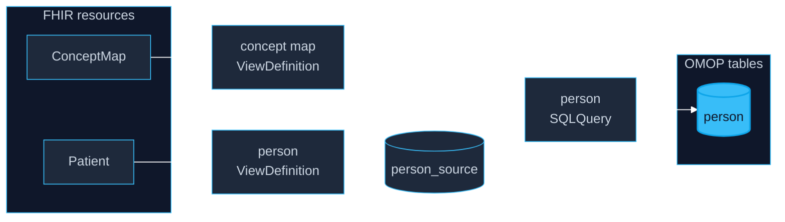

import ViewingRoomWC from '@site/src/components/ViewingRoomWC';

# FHIR → OMOP

A step-by-step walkthrough that builds **one** OMOP table from FHIR, end
to end: the `person` table, from a 25-patient cohort. It is deliberately
small — one resource type, a handful of columns, one code to translate.
Every other OMOP table is the same recipe with more columns.

Two ViewDefinitions reshape, one SQLQuery composes. All three are
standard SQL-on-FHIR artifacts, plus a ConceptMap, which is plain FHIR.



## Two ways to describe the same person

**FHIR** is how clinical systems *exchange* data. A patient is a nested
JSON document — a birth date, a gender code, lists of names. A medication
is another document that points back at the patient. It is flexible and
easy to send.

**OMOP** is how analysts *study* data. Everything is a flat table joined
by ids, and clinical meaning is carried by numbers called **concept ids**:
`8507` means male, `8532` means female. It is rigid, boring, and fast to
query at population scale.

So going from one to the other is always two moves:

1. **Reshape** the documents into tables.
2. **Translate** the codes into concept ids.

## Step 1 — Reshape: documents into columns

The `person` table needs an id, a birth date split into year / month /
day, and a gender. A patient resource already has all of it — just nested
in one JSON document.

A **ViewDefinition** says which pieces to keep and what to call them. It
is a small JSON file, and it is the whole of the reshaping step:

```json
{
  "name": "omop_person_source",
  "resource": "Patient",
  "select": [
    {
      "column": [
        { "name": "person_id",           "path": "id",                        "type": "id" },
        { "name": "year_of_birth",       "path": "birthDate.substring(0, 4)", "type": "string" },
        { "name": "month_of_birth",      "path": "birthDate.substring(5, 2)", "type": "string" },
        { "name": "day_of_birth",        "path": "birthDate.substring(8, 2)", "type": "string" },
        { "name": "birth_datetime",      "path": "birthDate",                 "type": "dateTime" },
        { "name": "person_source_value", "path": "id",                        "type": "id" },
        { "name": "gender_source_value", "path": "gender",                    "type": "code" }
      ]
    }
  ]
}
```

Read it as a recipe:

- **`resource`** — start from `Patient`. The engine looks at nothing else.
- **`column`** — each entry becomes a column: `name` is the header,
  `path` says where the value lives.
- **`path`** is a **FHIRPath** expression, a compact way of pointing into
  a resource. `birthDate` is text in FHIR, so `substring(0, 4)` takes the
  year and `substring(5, 2)` the month.
- **`type`** tells the engine what kind of value to expect, so the column
  comes out usable (`id`, `string`, `code`) rather than all text.

On our cohort that gives 25 rows — one per patient:

| person_id | person_source_value | year_of_birth | gender_source_value |
|---|---|---|---|
| `262d2fc9-bc42-2b6e-5eb6-9ab41705f492` | `262d2fc9-bc42-2b6e-5eb6-9ab41705f492` | 1982 | `male` |
| `7ef7fab9-63b4-1376-94be-c9760d4f94f7` | `7ef7fab9-63b4-1376-94be-c9760d4f94f7` | 1967 | `female` |
| `80402b87-2275-392f-bf13-7c25fed62f2c` | `80402b87-2275-392f-bf13-7c25fed62f2c` | 1966 | `male` |

This is the reshape only — the ids are still the FHIR strings, and the
last column is still the FHIR code. OMOP wants `8507` or `8532`.

## Step 2 — Translate: codes into concept ids

A **ConceptMap** is a standard FHIR resource whose only job is to say
"this code in this system means that code in that system". It is not part
of SQL-on-FHIR — any conformant FHIR server can hold one. Here is a real
excerpt from the cohort's map:

```json
{
  "resourceType": "ConceptMap",
  "status": "active",
  "group": [
    {
      "source": "http://hl7.org/fhir/administrative-gender",
      "target": "urn:omop:concept",
      "element": [
        { "code": "male",   "target": [{ "code": "8507", "equivalence": "equivalent" }] },
        { "code": "female", "target": [{ "code": "8532", "equivalence": "equivalent" }] }
      ]
    }
  ]
}
```

One ConceptMap holds every vocabulary, one `group` per source system. This
dataset's map carries **108,683 mappings** — RxNorm drugs, CVX vaccine
codes, and small supplements for gender and encounter classes. The
`target.code` is the OMOP concept id (written as text); `equivalence`
records confidence, and the library only accepts the strong values
(`equivalent`, `equal`, `wider`, `subsumes`).

To use it, the map itself becomes a table. A second ViewDefinition walks
the resource's own structure — `group`, then `element`, then `target` —
and emits one row per mapping:

```json
{
  "name": "omop_conceptmap",
  "resource": "ConceptMap",
  "select": [{
    "forEach": "group",
    "column": [{ "name": "source_system", "path": "source" }],
    "select": [{
      "forEach": "element",
      "column": [{ "name": "concept_code", "path": "code" }],
      "select": [{
        "forEach": "target.where(equivalence = 'equivalent' or equivalence = 'equal').first()",
        "column": [
          { "name": "concept_id",  "path": "code" },
          { "name": "equivalence", "path": "equivalence" }
        ]
      }]
    }]
  }]
}
```

The nesting mirrors the resource: for each group, for each element, take
the first target we trust. The result is an ordinary lookup table —
`source_system + concept_code → concept_id`.

## Step 3 — Compose: join the two in a SQLQuery

A ViewDefinition sees exactly one resource type, so it cannot join — that
is what a **SQLQuery** is for. It is a FHIR `Library` resource of type
`sql-query` whose body is ordinary SQL over the view names:

```json
{
  "resourceType": "Library",
  "status": "active",
  "type": { "coding": [{ "code": "sql-query" }] },
  "meta": { "profile": ["http://hl7.org/fhir/uv/sql-on-fhir/StructureDefinition/SQLQuery"] },
  "content": [{ "contentType": "application/sql", "data": "LS0gT01PUCBwZXJzb246IHRoZSByYXcgcmVzaGFwZSBqb2luZWQg..." }]
}
```

`content.data` is the query, base64 encoded. Decoded, it is the whole of
the `person` table:

```sql
SELECT
    CAST(hash(p.person_id) & 9223372036854775807 AS BIGINT) AS person_id,
    COALESCE(TRY_CAST(cm.concept_id AS BIGINT), 0)          AS gender_concept_id,
    p.year_of_birth,
    p.month_of_birth,
    p.day_of_birth,
    p.birth_datetime,
    p.person_source_value,
    p.gender_source_value
FROM omop.person_source AS p
LEFT JOIN omop.omop_conceptmap AS cm
       ON p.gender_source_value = cm.concept_code
      AND cm.source_system = 'http://hl7.org/fhir/administrative-gender';
```

The join matches on **both** the code and the source system — without the
second condition a drug code could match a gender. `person_source_value`
keeps the FHIR id, so the integer `person_id` never hides the source
record.

The result is a finished `person` row:

| person_id | person_source_value | gender_concept_id | gender_source_value |
|---|---|---|---|
| 1170511711334034253 | `262d2fc9-bc42-2b6e-5eb6-9ab41705f492` | 8507 | `male` |
| 3325726062766785590 | `7ef7fab9-63b4-1376-94be-c9760d4f94f7` | 8532 | `female` |
| 1074285768011624945 | `80402b87-2275-392f-bf13-7c25fed62f2c` | 8507 | `male` |

Because the join is a *left* join, a code the map does not know keeps its
row with an empty concept id — visible rather than silently dropped. In
this cohort every gender resolves.

## That is the whole recipe

- **Reshape** each resource type with a ViewDefinition.
- **Translate** codes with one shared ConceptMap, flattened once by
  another ViewDefinition into a lookup table.
- **Compose** with a SQLQuery: joins, unions and the integer ids all live
  in the SQL, so every artifact stays portable. `drug_exposure` is the
  classic composition: prescriptions, dispensings, statements,
  administrations and immunizations unioned into one table.

The rest of the library — encounters, conditions, procedures,
measurements, observations, deaths — is the same three moves with
different columns.

## Try it

Both halves run live below, in your browser: Pyodide brings up FHIR4DS,
DuckDB-WASM runs the queries, and the data comes straight from
[Hugging Face](https://huggingface.co/datasets/fhir4ds/omop-demo). Start
with **OMOP person (view)** to see the reshape, then **OMOP person
(SQLQuery)** for the finished table.

:::info
First boot takes 30–60 seconds (~30 MB); later visits are cached. Nothing
is sent anywhere — the query runs on your machine.
:::

<ViewingRoomWC height="85vh" suite="omop" popout />

## Where to go next

- [OMOP CDM v5.5 Mapping](/docs/user-guide/modeling/omop-mapping) — the
  full library (13 tables), coverage and ETL conventions.
- [ViewDefinition](/docs/user-guide/modeling/viewdef) — the reshaping
  specification in depth.
- [The view library](https://github.com/fhir4ds/fhir4ds/tree/main/fhir4ds/viewdef/resources/omop)
  — every OMOP ViewDefinition and SQLQuery, plus the composition manifest.
- Notebook: `docs/notebooks/omop-mapping.ipynb` — the same steps in
  Python, cell by cell.
