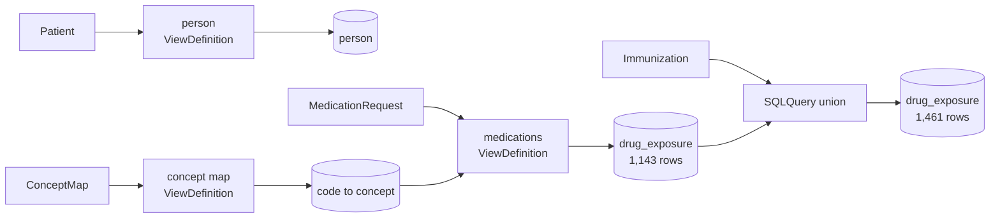

import ViewingRoomWC from '@site/src/components/ViewingRoomWC';

# OMOP, Step by Step

You have FHIR. You want OMOP. This page builds three OMOP tables from a
real FHIR R4 cohort, and explains each piece only when it is needed.

By the end you will have:

- **`person`** — one row per patient, with gender as an OMOP concept id.
- **`drug_exposure`** — one row per prescribed drug, with the drug code
  converted to a standard concept.
- **`drug_exposure`, complete** — the same table, now including vaccines
  and every other FHIR medication resource type.

No FHIR knowledge is assumed beyond "resources are JSON documents". No SQL
is needed until the last step, where it is the point.



## Two ways to describe the same person

**FHIR** is how clinical systems *exchange* data. A patient is a nested
JSON document: a birth date, a gender code, lists of names and
identifiers. A medication is another document that *points at* the
patient. It is rich, flexible, and easy to send.

**OMOP** is how analysts *study* data. Everything lives in flat tables
joined by ids. Clinical meaning is carried by numbers called **concept
ids** — `8507` means male, `19009384` is a particular RxNorm drug — which
come from standard vocabularies. It is rigid, boring, and very fast to
query.

Getting from one to the other takes two independent moves: **reshape**
the documents into tables, and **translate** the codes into concept ids.
SQL-on-FHIR does the reshaping; a FHIR ConceptMap does the translating.

## Step 1 — A table from one kind of resource

The first OMOP table, `person`, needs a patient id, a birth date split
into year / month / day, and a gender. FHIR already has all of it — it is
just nested inside one JSON document.

A **ViewDefinition** says which pieces to keep and what to call them. It
is a small JSON file, and it is the whole of the SQL-on-FHIR "reshape"
step:

```json
{
  "name": "omop_person",
  "resource": "Patient",
  "select": [
    {
      "column": [
        { "name": "person_id",           "path": "id",                        "type": "id" },
        { "name": "year_of_birth",       "path": "birthDate.substring(0, 4)", "type": "string" },
        { "name": "month_of_birth",      "path": "birthDate.substring(5, 2)", "type": "string" },
        { "name": "day_of_birth",        "path": "birthDate.substring(8, 2)", "type": "string" },
        { "name": "gender_source_value", "path": "gender",                    "type": "code" }
      ]
    }
  ]
}
```

Read it as a recipe:

- **`resource`** — start from `Patient`. The engine only looks at those.
- **`column`** — each entry becomes a column. `name` is the output
  header; `path` says where the value lives inside the resource.
- **`path`** is a **FHIRPath** expression: a compact way of pointing into
  a resource. `birthDate` is a string in FHIR, so `substring(0, 4)` takes
  the year, `substring(5, 2)` the month, and so on.
- **`type`** tells the engine what kind of value to expect, so the column
  comes out usable (`id`, `string`, `code`) instead of "everything is
  text".

That file alone produces the table. On our 25-patient cohort:

| person_id | year_of_birth | month_of_birth | day_of_birth | gender_source_value |
|---|---|---|---|---|
| `e61b54c7-8ae8-907c-4e6d-20f5e86eca63` | 1957 | 01 | 26 | `female` |
| `7a4ff83b-37bc-fe9a-b385-d2615aeac488` | 1998 | 06 | 02 | `female` |
| `4e3be038-c545-8835-4859-86cb59cee238` | 1972 | 11 | 09 | `male` |

Twenty-five rows, one per patient. The last column is still the FHIR
code — `male`, `female`. OMOP wants `8507` and `8532`. That is step 2.

## Step 2 — Turning codes into concept ids

A **ConceptMap** is a standard FHIR resource whose only job is to say
"this code in this system means that code in that system". It is not part
of SQL-on-FHIR; it is plain FHIR, and any conformant server can store it.
Here is a real excerpt from the cohort's map:

```json
{
  "resourceType": "ConceptMap",
  "status": "active",
  "group": [
    {
      "source": "http://hl7.org/fhir/administrative-gender",
      "target": "urn:omop:concept",
      "element": [
        { "code": "male",   "target": [{ "code": "8507", "equivalence": "equivalent" }] },
        { "code": "female", "target": [{ "code": "8532", "equivalence": "equivalent" }] }
      ]
    }
  ]
}
```

One ConceptMap holds every vocabulary, one `group` per source system. In
this dataset it carries **108,683 mappings**: RxNorm drugs, CVX vaccine
codes, and small supplements for gender and encounter classes. The
`target.code` is the OMOP concept id, written as text; `equivalence`
records how sure the mapping is, and the library only accepts the strong
ones (`equivalent`, `equal`, `wider`, `subsumes`).

To use it, the map itself becomes a table. A second ViewDefinition walks
the resource's own structure — `group`, then `element`, then `target` —
and emits one row per mapping:

```json
{
  "name": "omop_conceptmap",
  "resource": "ConceptMap",
  "select": [{
    "forEach": "group",
    "column": [{ "name": "source_system", "path": "source" }],
    "select": [{
      "forEach": "element",
      "column": [{ "name": "concept_code", "path": "code" }],
      "select": [{
        "forEach": "target.where(equivalence = 'equivalent' or equivalence = 'equal').first()",
        "column": [
          { "name": "concept_id",  "path": "code" },
          { "name": "equivalence", "path": "equivalence" }
        ]
      }]
    }]
  }]
}
```

The nesting mirrors the resource: for each group, for each element, take
the first target we trust. The result is an ordinary lookup table:
`source_system | concept_code → concept_id`.

Now the medications ViewDefinition can use it. It reads
`MedicationRequest`, keeps the drug code, and adds one column taken from
the map:

```json
{
  "name": "omop_drug_exposure_medication_request",
  "resource": "MedicationRequest",
  "select": [{
    "column": [
      { "name": "drug_exposure_id",  "path": "id",                                        "type": "id" },
      { "name": "person_id",         "path": "subject.reference.split('/').last()",        "type": "string" },
      { "name": "drug_concept_id",   "path": "cm.concept_id",                              "type": "string" },
      { "name": "drug_source_value", "path": "medication.ofType(CodeableConcept).coding.code.first()", "type": "code" }
    ]
  }],
  "joins": [{
    "name": "cm",
    "view": "omop_conceptmap",
    "type": "left",
    "on": [
      { "path": "medication.ofType(CodeableConcept).coding.code.first()" },
      { "path": "cm.concept_code" }
    ]
  }]
}
```

`drug_concept_id` is simply `cm.concept_id` — a value the map supplies.
The `on` list pairs up the expressions to match on: the resource's drug
code on the left, the map's `concept_code` on the right.

:::note
`joins` is a **fhir4ds extension**, not part of the SQL-on-FHIR
specification. It is convenient for a library of related views, and the
next step shows the standards-based alternative — a SQLQuery.
:::

The result is 1,143 rows, one per prescription, with **zero unmapped
drugs**:

| drug_source_value | drug_concept_id |
|---|---|
| 106892 | 19009384 |
| 106258 | 19008572 |

Because the join is a *left* join, a code the map does not know keeps its
row with an empty concept — visible rather than silently dropped.

## Step 3 — One table from five kinds of resource

`drug_exposure` is not fed by one resource type. Prescriptions,
dispensings, statements, administrations and immunizations are all drug
exposures in OMOP, and each lives in its own FHIR resource.

A ViewDefinition sees exactly one resource type, so SQL-on-FHIR answers
this with a **SQLQuery**: a FHIR `Library` resource whose body is a SQL
query over the views. This is the piece of SQL worth reading, because it
*is* the artifact:

```sql
SELECT drug_exposure_id, person_id, drug_concept_id,
       drug_exposure_start_date, drug_exposure_end_date,
       drug_type_concept_id, drug_source_value, src
FROM omop.drug_exposure__medication_request
UNION ALL
SELECT ... FROM omop.drug_exposure__medication_dispense
UNION ALL
SELECT ... FROM omop.drug_exposure__medication_statement
UNION ALL
SELECT ... FROM omop.drug_exposure__medication_administration
UNION ALL
SELECT ... FROM omop.drug_exposure__immunization
ORDER BY drug_exposure_start_date, src;
```

The query is stored in the Library as base64 text, alongside the profile
that marks it as a SQLQuery:

```json
{
  "resourceType": "Library",
  "status": "active",
  "type": { "coding": [{ "code": "sql-query" }] },
  "meta": { "profile": ["http://hl7.org/fhir/uv/sql-on-fhir/StructureDefinition/SQLQuery"] },
  "content": [{ "contentType": "application/sql", "data": "LS0gQ3Jvc3MtcmVzb3VyY2UgT01PUCBkcnVnX2V4cG9zdXJl..." }]
}
```

`UNION ALL` — not `UNION` — because two dispensings of the same drug on
the same day are two exposures, not one row. Each arm keeps its `src`
column, so any row can be traced back to the FHIR resource type that
produced it.

| src | rows | unmapped |
|---|---|---|
| MedicationRequest | 1,143 | 0 |
| Immunization | 318 | 0 |
| **total** | **1,461** | **0** |

## Try it

The same three steps run below, entirely in your browser: Pyodide brings
up FHIR4DS, DuckDB-WASM does the SQL, and the data comes straight from
[Hugging Face](https://huggingface.co/datasets/fhir4ds/omop-demo). Pick a
sample from the gallery — `OMOP person`, then the two medications samples
— and watch the row counts and concept ids change as you switch.

:::info
First boot takes 30–60 seconds (~30 MB); later visits are cached. Nothing
is sent anywhere: the query runs on your machine.
:::

<ViewingRoomWC height="85vh" suite="omop" popout />

## Where to go next

- [OMOP CDM v5.5 Mapping](/docs/user-guide/modeling/omop-mapping) — the
  full library (13 tables), coverage and ETL conventions.
- [ViewDefinition](/docs/user-guide/modeling/viewdef) — the reshaping
  specification in depth.
- [OMOP Demo](/docs/examples/omop-viewer) — browse the composed tables.
- Notebook: `docs/notebooks/omop-mapping.ipynb` — the same steps in
  Python, cell by cell.
