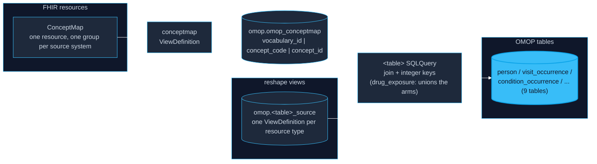

# OMOP CDM v5.5 Mapping

fhir4ds ships a ViewDefinition library that maps FHIR R4 resources to
OMOP CDM v5.5 tables. Concepts resolve **at query time** through the
rev-2 view-as-join-target architecture — no ETL staging of vocabulary
tables, no offline code mapping step.

## Architecture



The chain is spec-grounded: SQL-on-FHIR composition semantics state that
"each referenced result acts as a virtual table for the referencing
query" — the engine may materialize the view's result or inline it.

Unmapped codes keep their source values with `concept_id = 0` (valid
OMOP); mappings can be swapped by restaging the ConceptMap without
touching a single ViewDefinition.

## The ConceptMap contract

The converter (the medterm4ds Athena pipeline, or any producer) emits a
standard FHIR ConceptMap: one group per source system
(`http://loinc.org`, `http://snomed.info/sct`, RxNorm, ICD-10-CM, CVX,
...), elements carrying `code` → `target.code` = the OMOP `concept_id`
as a string, `target.equivalence` of `equivalent`/`equal`/`wider`/
`subsumes`. The conceptmap ViewDefinition takes the FIRST
equivalence-passing target per code — a strict `(system, code) →
concept_id` functional dependency — so a code with multiple targets can
never fan out event rows.

Small curated supplements (`conceptmap-supplements.json`) cover codes no
Athena vocabulary provides: administrative-gender → Gender domain
concepts, v3-ActCode encounter classes → Visit concepts, and condition
categories → Type Concepts.

## Using the library

```python
import fhir4ds
from fhir4ds.viewdef.omop_runner import create_omop_views

con = fhir4ds.create_connection()
con.execute("CREATE TABLE resources (resource JSON)")
# stage FHIR resources + your ConceptMap(s) into `resources` ...
create_omop_views(con, source_table="resources")

con.execute("SELECT * FROM omop.person").df()
```

`create_omop_views` composes the whole `omop.*` schema:

- **Dependency inference**: materialization entries are created first, then
  each SQLQuery after the `<schema>.<view>` names its SQL reads (cycles and
  unknown references are typed errors).
- **SQLQuery steps**: `manifest.sql_queries` maps a table to a FHIR
  `Library` of type `sql-query` under `sqlqueries/`. `person` is one:
  a plain reshape ViewDefinition plus a SQLQuery that performs the join
  and key assignment, so nothing in that path needs a fhir4ds extension.
- **Unions**: `drug_exposure`'s SQLQuery unions its five arm views
  (MedicationRequest / Statement / Administration / Dispense /
  Immunization) and joins the map once, instead of joining each arm.
- **Projections**: natural-key strings become stable positive 63-bit
  integer ids (`person_id`, `visit_occurrence_id`, ...); concept columns
  become `BIGINT` with `COALESCE 0` defaults.

The composition is manifest-driven (`manifest.json`); the generic runner
(`fhir4ds.viewdef.runner`) composes any view family the same way.

## Coverage

| OMOP table | FHIR source | Notes |
|---|---|---|
| person | Patient | gender via concept join; birthDate splits |
| visit_occurrence | Encounter | class → Visit concept; type 32810 default |
| condition_occurrence | Condition | SNOMED > ICD-10-CM coding precedence; category → Type Concept |
| procedure_occurrence | Procedure | SNOMED > CPT4 precedence; quantity 1 |
| drug_exposure | MedicationRequest + Statement + Administration + Immunization | 4-arm union; per-arm provenance type concepts |
| device_exposure | DeviceUsage | EHR type default |
| measurement / observation | Observation | value-type split: Quantity-valued → measurement |
| death | Patient.deceased | dateTime extraction |

ETL assumptions (type-concept defaults, provider/care-site 0-policy,
observation_period as a THEMIS ETL concern) are documented in the
[manifest](https://github.com/fhir4ds/fhir4ds/blob/main/fhir4ds/viewdef/resources/omop/manifest.json).
Field mappings are mined from the OMOP-on-FHIR v5.4-R4 project with
per-file attribution; the v5.5 delta (optional fields only) is noted
there too.

## Sample data

A real generated cohort for trying the library — a 25-patient
[Synthea](https://synthetichealth.github.io/synthea/) R4 cohort (MIT;
seed-pinned), hosted on Hugging Face:

- [fhir4ds/omop-demo](https://huggingface.co/datasets/fhir4ds/omop-demo)
  — NDJSON bundles (patients, encounters, medications + immunizations)
  and one ConceptMap carrying every vocabulary mapping.

Composing the library over the cohort yields: person 25 rows,
visit_occurrence 1,284, drug_exposure 1,461 (1,143 MedicationRequest +
318 Immunization), with every coded concept resolved.

### The ConceptMap: one resource, every vocabulary

A single ConceptMap resource carries all mappings, with one `group` per
source system:

| group source | mappings | covers |
|---|---|---|
| `.../rxnorm` | 108,421 | product-level RxNorm classes: Clinical Drug (SCD), Branded Drug (SBD), Quant Clinical Drug (SCDC), Quant Branded Drug, Clinical Pack (GPCK), Branded Pack (BPCK), Clinical Drug Comp, Branded Drug Comp |
| `.../sid/cvx` | 255 | immunization vaccine codes |
| `administrative-gender`, `v3-ActCode`, `condition-category` | 7 | person/encounter/condition supplements |

Every coded row in the cohort resolves — 54/54 RxCUIs (1,143/1,143
mentions) and 13/13 CVX codes. 27 MedicationRequests in the raw Synthea
output carry no medication code at all (`medicationCodeableConcept` is
null); they are not shipped, since a drug exposure with no drug has
nothing to map.

Element `display` fields are omitted (not needed for mapping);
`equivalence` is retained because FHIR requires it.

## Try it

The OMOP library ships with the package
(`fhir4ds.viewdef.resources.omop`): every ViewDefinition and SQLQuery,
plus the composition manifest. `create_omop_views` composes the whole
schema from any staged resources table.

- Conformance: `python3 conformance/scripts/run_omop.py` (38 checks —
  schema, required fields, grain, mapping, vd-conformance)
